**Label:**

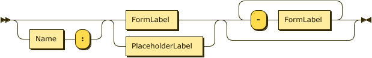

```
Label    ::= ( Name ':' )? ( FormLabel | PlaceholderLabel ) ( '-' FormLabel )*
```

**FormLabel:**

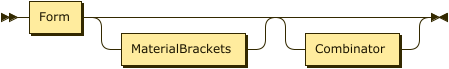

```
FormLabel
         ::= Form MaterialBrackets? Combinator?
```

referenced by:

* Label

**PlaceholderLabel:**

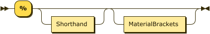

```
PlaceholderLabel
         ::= '%' Shorthand? MaterialBrackets?
```

referenced by:

* Label

**Name:**

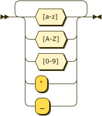

```
Name     ::= [a-zA-Z0-9'_]+
```

referenced by:

* Entry
* Label

**Form:**

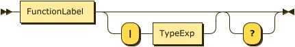

```
Form     ::= FunctionLabel ( '|' TypeExp )? '?'?
```

referenced by:

* FormLabel

**FunctionLabel:**

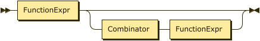

```
FunctionLabel
         ::= FunctionExpr ( Combinator FunctionExpr )?
```

referenced by:

* Form

**Combinator:**

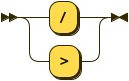

```
Combinator
         ::= '/'
           | '>'
```

referenced by:

* FormLabel
* FunctionLabel

**FunctionExpr:**

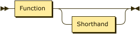

```
FunctionExpr
         ::= Function Shorthand?
```

referenced by:

* FunctionLabel

**Function:**

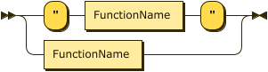

```
Function ::= '"' FunctionName '"'
           | FunctionName
```

referenced by:

* FunctionExpr

**FunctionName:**

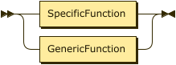

```
FunctionName
         ::= SpecificFunction
           | GenericFunction
```

referenced by:

* Function

**GenericFunction:**

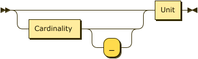

```
GenericFunction
         ::= ( Cardinality '_'? )? Unit
```

referenced by:

* FunctionName

**Cardinality:**

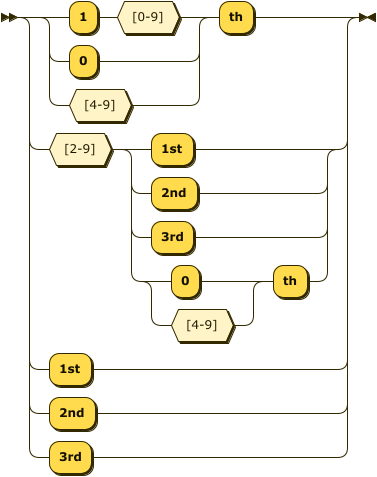

```
Cardinality
         ::= ( '1' [0-9] | [04-9] ) 'th'
           | [2-9] ( '1st' | '2nd' | '3rd' | [04-9] 'th' )
           | '1st'
           | '2nd'
           | '3rd'
```

referenced by:

* GenericFunction

**Unit:**

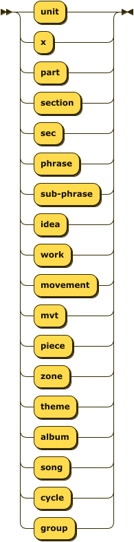

```
Unit     ::= 'unit'
           | 'x'
           | 'part'
           | 'section'
           | 'sec'
           | 'phrase'
           | 'sub-phrase'
           | 'idea'
           | 'work'
           | 'movement'
           | 'mvt'
           | 'piece'
           | 'zone'
           | 'theme'
           | 'album'
           | 'song'
           | 'cycle'
           | 'group'
```

referenced by:

* FormalType
* GenericFunction

**SpecificFunction:**

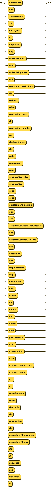

```
SpecificFunction
         ::= 'antecedent'
           | 'ant'
           | 'after-the-end'
           | 'ate'
           | 'basic_idea'
           | 'bi'
           | 'beginning'
           | 'beg'
           | 'cadential_idea'
           | 'cadi'
           | 'cadential_phrase'
           | 'cad'
           | 'compound_basic_idea'
           | 'cbi'
           | 'codetta'
           | 'cdta'
           | 'contrasting_idea'
           | 'ci'
           | 'contrasting_middle'
           | 'cm'
           | 'closing_theme'
           | 'cls'
           | 'coda'
           | 'consequent'
           | 'cons'
           | 'continuation_idea'
           | 'continuation'
           | 'conti'
           | 'cont'
           | 'development_section'
           | 'dev'
           | 'end'
           | 'essential_expositional_closure'
           | 'eec'
           | 'essential_sonata_closure'
           | 'esc'
           | 'exposition'
           | 'exp'
           | 'fragmentation'
           | 'frag'
           | 'introduction'
           | 'intro'
           | 'lead-in'
           | 'lin'
           | 'middle'
           | 'mid'
           | 'model'
           | 'mod'
           | 'postcadential'
           | 'pcad'
           | 'presentation'
           | 'pres'
           | 'primary_theme_zone'
           | 'primary_theme'
           | 'ptz'
           | 'pt'
           | 'recapitulation'
           | 'recap'
           | 'ritornello'
           | 'rit'
           | 'retransition'
           | 'rtr'
           | 'standing_on_the_dominant'
           | 'sod'
           | 'secondary_theme_zone'
           | 'secondary_theme'
           | 'stz'
           | 'st'
           | 'sequence'
           | 'seq'
           | 'transition'
           | 'tr'
```

referenced by:

* FunctionName

**TypeExp:**

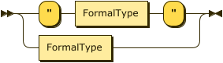

```
TypeExp  ::= '"' FormalType '"'
           | FormalType
```

referenced by:

* Form

**FormalType:**

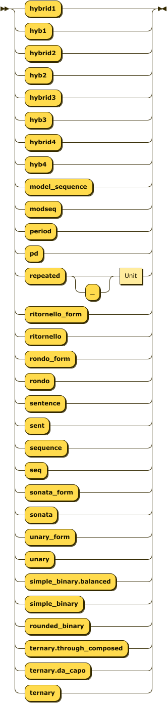

```
FormalType
         ::= 'hybrid1'
           | 'hyb1'
           | 'hybrid2'
           | 'hyb2'
           | 'hybrid3'
           | 'hyb3'
           | 'hybrid4'
           | 'hyb4'
           | 'model_sequence'
           | 'modseq'
           | 'period'
           | 'pd'
           | 'repeated' '_'? Unit
           | 'ritornello_form'
           | 'ritornello'
           | 'rondo_form'
           | 'rondo'
           | 'sentence'
           | 'sent'
           | 'sequence'
           | 'seq'
           | 'sonata_form'
           | 'sonata'
           | 'unary_form'
           | 'unary'
           | 'simple_binary.balanced'
           | 'simple_binary'
           | 'rounded_binary'
           | 'ternary.through_composed'
           | 'ternary.da_capo'
           | 'ternary'
```

referenced by:

* TypeExp

**MaterialBrackets:**

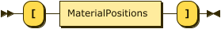

```
MaterialBrackets
         ::= '[' MaterialPositions ']'
```

referenced by:

* FormLabel
* PlaceholderLabel

**MaterialPositions:**

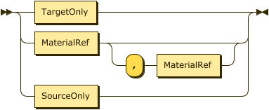

```
MaterialPositions
         ::= TargetOnly
           | MaterialRef ( ',' MaterialRef )?
           | SourceOnly
```

referenced by:

* MaterialBrackets

**TargetOnly:**

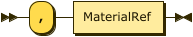

```
TargetOnly
         ::= ',' MaterialRef
```

referenced by:

* MaterialPositions

**SourceOnly:**

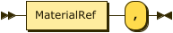

```
SourceOnly
         ::= MaterialRef ','
```

referenced by:

* MaterialPositions

**MaterialRef:**

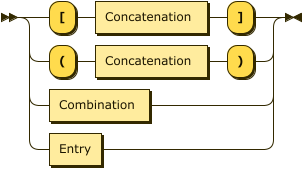

```
MaterialRef
         ::= '[' Concatenation ']'
           | '(' Concatenation ')'
           | Combination
           | Entry
```

referenced by:

* MaterialPositions
* SourceOnly
* TargetOnly

**Concatenation:**

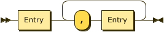

```
Concatenation
         ::= Entry ( ',' Entry )+
```

referenced by:

* MaterialRef

**Combination:**

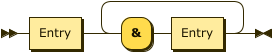

```
Combination
         ::= Entry ( '&' Entry )+
```

referenced by:

* MaterialRef

**Shorthand:**

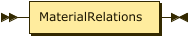

```
Shorthand
         ::= MaterialRelations
```

referenced by:

* FunctionExpr
* PlaceholderLabel

**MaterialKeyword:**

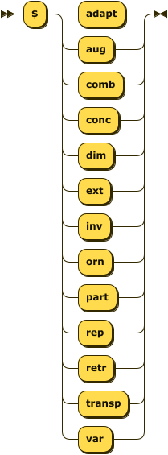

```
MaterialKeyword
         ::= '$' ( 'adapt' | 'aug' | 'comb' | 'conc' | 'dim' | 'ext' | 'inv' | 'orn'
                  | 'part' | 'rep' | 'retr' | 'transp' | 'var' )
```

referenced by:

* MaterialRelations

**MaterialOperator:**

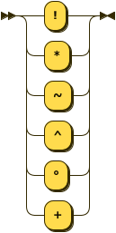

```
MaterialOperator
         ::= [!*~^°+]
```

referenced by:

* MaterialRelations

**MaterialRelations:**

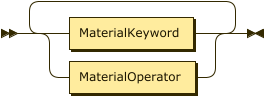

```
MaterialRelations
         ::= ( MaterialKeyword | MaterialOperator )+
```

referenced by:

* Entry
* Shorthand

**Entry:**

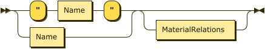

```
Entry    ::= ( '"' Name '"' | Name ) MaterialRelations?
```

referenced by:

* Combination
* Concatenation
* MaterialRef

## 
 <sup>generated by [RR - Railroad Diagram Generator][RR]</sup>

[RR]: https://www.bottlecaps.de/rr/ui